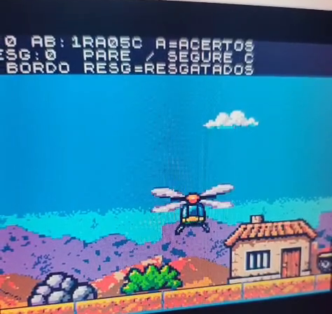

# Resgate Aéreo — Developer Preview PUB03C

**Jogo experimental para Fuse-TKGA**, com arte independente da linhagem PUB03B. **Criação, concepção e coordenação do desenvolvimento: José Albuquerque**, com assistência de IA.

**[Assistir ao vídeo real editado (MP4, 4,4 s)](./PUB03C/media/gameplay-real.mp4)** · [GIF derivado da mesma filmagem](./PUB03C/media/gameplay-real.gif)

A mídia acima foi recortada de um vídeo que o autor enviou em 16/11/2026, filmando o jogo na tela. Não há quadros inventados, redesenho de sprites ou simulação artística. Trata-se de filmagem do monitor, não captura direta do framebuffer; o áudio foi retirado do MP4 editado.

## Jogue e explore

- [Baixar o jogo TAP — 22.227 bytes](./PUB03C/resgate-aereo-pub03b.tap)
- [Baixar pacote completo: fontes, geradores, arte, TAP, mídia e testes](./PUB03C/RESGATE_AEREO_PUB03C_PREVIEW.zip)
- [Ver gameplay filmado — MP4](./PUB03C/media/gameplay-real.mp4)
- [Ver GIF compacto extraído do mesmo vídeo](./PUB03C/media/gameplay-real.gif)
- [Ver fotograma do vídeo](./PUB03C/media/gameplay-real.png)

**SHA-256 ZIP:** `991ca7092d4a17ffc539ac4f96bc1f83dc917d9079da7a6342391196a92d3266`  
**SHA-256 TAP:** `6ea589cf46f527e76148d7b50eb6f12b6905aea4f39ce7281a5fbc7be2af37f3`.

Para executar, obtenha e compile o [Fuse-TKGA PUB03C](../../fuse-tkga/README.md), utilize uma ROM Spectrum 48K que possa usar licitamente, e carregue o TAP. A construção do TAP foi verificada **sem ROM**.

## Controles

| Teclas | Ação |
|---|---|
| Q / A | Subir / descer |
| O / P | Deslocamento lateral |
| Z / X | Girar |
| V | Corda / cancelar antes do contato, quando aplicável |
| C | Resgate pousado e entrega |
| R | Reiniciar |

Pouse à direita do hangar para completar a entrega.

## Estado de desenvolvimento

- Fonte, ferramentas e assets independentes foram reconstruídos em diretórios limpos, produzindo o **mesmo TAP byte a byte**.
- Boot e capa foram ensaiados no Fuse compilado da seleção pública.
- Voo, içamento, caminhada, entrega e reset foram exercitados por **automação** na campanha PUB03B; as evidências dessa campanha são automatizadas. O novo vídeo foi fornecido pelo autor e mostra o jogo no monitor; não deve ser confundido com uma aceitação sistemática de controles.
- **Teclado humano e execução no TK físico: NOT_RUN**. Portanto, esta é uma prévia jogável *experimental*, não homologada.

## Licenças e créditos

Filme enviado pelo autor e derivados: crédito **José Albuquerque**. O GIF anterior da fixture foi retirado da vitrine (a cópia no ZIP histórico permanece intacta). [Proveniência desta nova mídia](./PUB03C/media/VIDEO_REAL_PROVENIENCIA.md).

Código próprio: **GPL-3.0-or-later**. Arte independente isolada, capturas e documentação original: **CC BY-SA 4.0**, com crédito a José Albuquerque. Adaptação integrada no TAP sob GPLv3, conforme `LICENSES.md` e `CREDITS.md` dentro do ZIP. Outras ferramentas e emuladores preservam os respectivos titulares; ROM comercial e arte RA01 não estão incluídas.

[Política de atribuição](../../POLITICA_COPYLEFT.md) · [Referência TKGA](../../docs/MANUAL.md).
